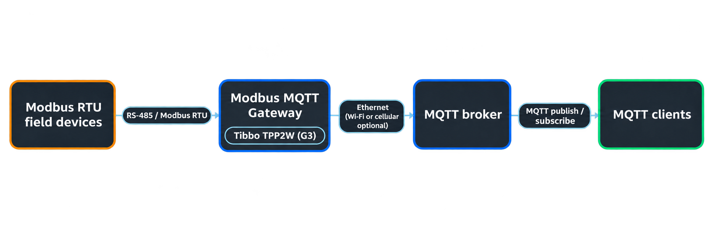
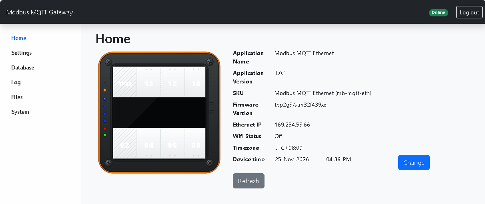
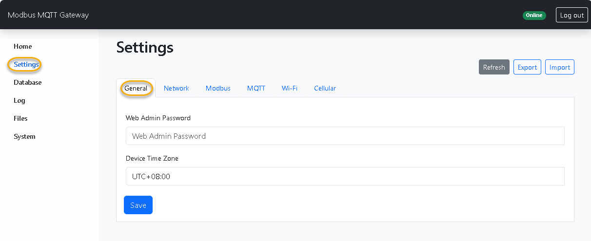
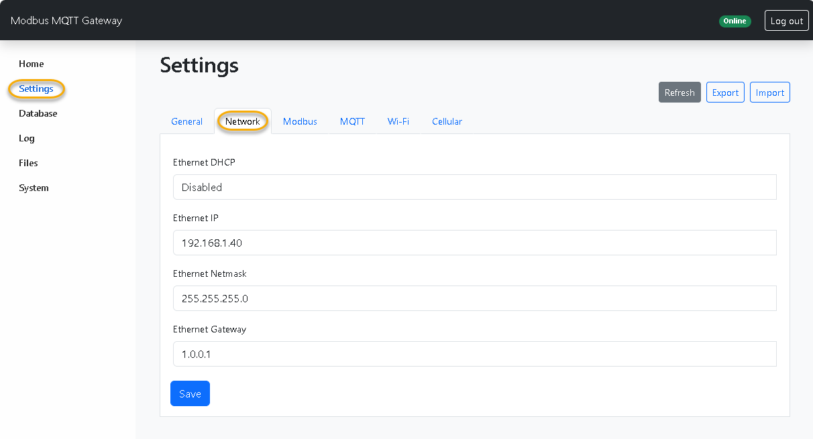

---
> **Application:** `ModbusMQTTGatewayG3` v0.1.19  
> **Firmware:** `ModbusMQTTGatewayG3` v1.0.1  
> **Platform:** Tibbo TPP2W(G3)

 

---

## Bookmarks

- [1. Overview](#1-overview)
- [2. Hardware](#2-hardware)
- [3. Network configuration and services](#3-network-configuration-and-services)
- [4. Modbus MQTT Gateway Console](#4-device-console)
  - [4.1 Home](#41-home)
  - [4.2 Settings](#42-settings)
    - [4.2.1 General](#421-general)
    - [4.2.2 Network](#422-network)
    - [4.2.3 Modbus](#423-modbus)
    - [4.2.4 MQTT](#424-mqtt)
    - [4.2.5 Wi-Fi](#425-wi-fi)
    - [4.2.6 Cellular](#426-cellular)
  - [4.3 Database](#43-database)
  - [Column reference](#column-reference)
  - [4.4 Log](#44-log)
  - [4.5 System](#45-system)
    - [4.5.1 Reboot Device](#451-reboot-device)
    - [4.5.2 Initialize Settings](#452-initialize-settings)
- [5. Deployment Example](#5-deployment-example)
  - [5.1 Connect the Modbus RTU devices](#51-connect-the-modbus-rtu-devices)
  - [5.2 Connect the network and power](#52-connect-the-network-and-power)
  - [5.3 Connect to the Modbus MQTT Gateway Console](#53-connect-to-the-modbus-mqtt-gateway-console)
    - [5.3.1 Settings](#531-settings)
      - [5.3.1.1 General](#5311-general)
      - [5.3.1.2 Network](#5312-network)
      - [5.3.1.3 Modbus](#5313-modbus)
    - [5.3.2 Database](#532-database)
      - [5.3.2.1 Configure Modbus Mapping in `DEVICES`](#5321-configure-modbus-mapping-in-devices)
      - [5.3.2.2 `REGISTER_VALUE`](#5322-register-value)
    - [5.3.3 Reboot Device](#533-reboot-device)
  - [5.4 EMQX](#54-emqx)
  - [5.5 Check Result](#55-check-result)
    - [5.5.1 Database: `REGISTER_VALUE`](#551-register-value)
    - [5.5.2 MQTTX Web Client](#552-mqttx-web-client)
- [6. Commissioning checklist](#6-commissioning-checklist)
- [7. Troubleshooting](#7-troubleshooting)

  

---

## 1. Overview [↑](#bookmarks "Back to Bookmarks")

The Modbus MQTT Gateway connects Modbus equipment, such as meters, sensors,
and controllers, to an MQTT broker. It periodically polls configured Modbus
points and publishes their values so MQTT clients can monitor or record them.

The user configures the Modbus points, polling and publishing intervals, and
MQTT connection. Published values use a topic formed from the configured base
topic and the register name. The application definition includes Ethernet,
Wi-Fi, and cellular variants; the supplied generated firmware is the Ethernet
build.

  

---

## 2. Hardware [↑](#bookmarks "Back to Bookmarks")

| Item | Detail |
| --- | --- |
| Controller | Tibbo TPP2W(G3) Tibbo Project PCB |
| Enclosure | TPB2, DIN-rail mounting kit, vibration-proof kit |
| Network | On-board 10/100 Base-T Ethernet with RJ45 |
| Wi-Fi (Optional) | Requires the Wi-Fi module |
| Cellular (Optional) | Requires the cellular modem module and antenna |
| Field interface | Tibbit #45 RS-485 interface for Modbus RTU, installed in socket 9 |
| Field connector | Tibbit #21 (4-terminal block), installed in socket 2 |
| Power | Tibbit #10 power supply module in socket 11 |
| Auxiliary module | Tibbit #18 in socket 12 |
| Power adapter | APR-P0008 adapter |
| Storage | 1 MB AT45DB081E dataflash, LittleFS file system |
| Status LEDs | On-board red/green LEDs used for the setup-error indication |
| MD button | On-board setup (MD) button. Hold for 5 s and release to reset all settings to their defaults |
| RST button | On-board restart (RST) button |

  

---

## 3. Network configuration and services [↑](#bookmarks "Back to Bookmarks")

| Item | Setting |
| --- | --- |
| Ethernet | static IP/netmask/gateway, or DHCP  |
| Wi-Fi (optional) | Station mode; DHCP or static IP/netmask/gateway; configure the SSID, security type, and password |
| Cellular (optional) | Configure the carrier's Access Point Name (APN) and SIM Card Pin in the Cellular settings |
| Time sync | SNTP against 216.239.35.0 (time.google.com), applied with the configured time zone |
| `Modbus MQTT Gateway Console` | HTTP, port 80, 3 concurrent connections |

 

> **Ethernet:**
> - Out of the box, Ethernet DHCP is **disabled** and the device uses the
>   **default** static IP address `192.168.1.40`. This placeholder makes the
>   device reachable on first power-up; change it to match your network.
> - When Ethernet DHCP is enabled, use the address assigned by your DHCP server
>   instead.

> **Wi-Fi:**
> - Wi-Fi is enabled in **Station** mode with DHCP enabled, but is not
>   configured to join a network until you enter its SSID and password.

> **Cellular:**
> - For optional cellular, enter the carrier's APN and the SIM Card Pin in the
>   Cellular settings.
> - Cellular connectivity requires an installed modem, an active SIM, and
>   compatible coverage.

> **NOTE:** A **network connection** is required for communication between the device
> and its configured SNTP servers and MQTT broker.

  

---

## 4. Modbus MQTT Gateway Console [↑](#bookmarks "Back to Bookmarks")

The **Modbus MQTT Gateway Console** is the gateway's browser-based interface
for viewing data and configuring the device. To open it, enter
`http://<device-ip>` in your web browser.

 

### 4.1 Home [↑](#bookmarks "Back to Bookmarks")

The **Home** page gives you an overview of the gateway.

> **NOTE:**
> - Select **Refresh** to update the information.
> - Select **Change** to adjust the device time settings if needed.

 

### 4.2 Settings [↑](#bookmarks "Back to Bookmarks")

The **Settings** page groups configuration options into tabs for the network,
Modbus polling, and MQTT connection.

> **Reminder:**
> - Restart the device after changing a setting.
> - The new value takes effect after restart.

#### 4.2.1 General [↑](#bookmarks "Back to Bookmarks")

Start with the **General** tab to configure the `Web Admin Password` and
`Device Time Zone`.

> **NOTE:** When you log in, use `Web Admin Username = admin`.

#### 4.2.2 Network [↑](#bookmarks "Back to Bookmarks")

For Ethernet, the **Network** tab gives you two options: use DHCP, or enter a
static IP address, netmask, and gateway.

> **NOTE:**
> - DHCP may assign a different IP address and interrupt your connection to the console.
> - If you want the device to remain reachable at a known address, use a **static** IP address.

#### 4.2.3 Modbus [↑](#bookmarks "Back to Bookmarks")

Use **Modbus** to configure the serial baud rate, parity, data bits, and poll
interval for the Modbus connection.

#### 4.2.4 MQTT [↑](#bookmarks "Back to Bookmarks")

Use **MQTT** to configure the broker address and port, TLS, client identity
and credentials, publish topic prefix, publish interval, and certificate files.

#### 4.2.5 Wi-Fi [↑](#bookmarks "Back to Bookmarks")

For Wi-Fi configurations, set the access point SSID, security type, password,
and DHCP or static IP settings.

#### 4.2.6 Cellular [↑](#bookmarks "Back to Bookmarks")

For cellular configurations, enter the carrier's Access Point Name (APN) and
SIM Card Pin.

### 4.3 Database [↑](#bookmarks "Back to Bookmarks")

For each Modbus value to monitor, configure the relevant device and register.
The gateway polls the configured points and publishes their values to the MQTT
broker.

| Table | Purpose |
| --- | --- |
| `DEVICES` | User-configured Modbus device and register mappings |
| `REGISTER_VALUE` | Latest values read from the configured registers |
| `LOG` | Device event log |
| `MODBUS_VALUES_LOG` | Timestamped Modbus values |
| `MQTT_OUTBOX` | QoS 1 and QoS 2 MQTT messages awaiting broker acknowledgement |

 

### Column reference [↑](#bookmarks "Back to Bookmarks")

The `DEVICES` table configures the Modbus points polled by the gateway.
Its fields include the Modbus device ID, register address, function code,
multiplier, and register name.

> **NOTE:** Enter each register address as shown in the connected Modbus
> device's register map. An incorrect address may prevent a valid polling
> result.

 

### 4.4 Log [↑](#bookmarks "Back to Bookmarks")

Use the **Log** area to review boot and reboot events. Its reboot-reason code
identifies why the device most recently booted or restarted.

| Reboot-reason code | Reason | Description |
| --- | --- | --- |
| `0` | `BOOT_REBOOT_NONE` | No reboot reason is recorded. |
| `1` | `BOOT_REBOOT_HARDWARE` | Hardware or external reset. This is informational. |
| `2` | `BOOT_REBOOT_FATAL` | The device restarted after `k_sys_fatal_error_handler` was invoked. |
| `3` | `BOOT_REBOOT_FORMAT` | The device restarted during file-system reformat recovery. |
| `4` | `BOOT_REBOOT_WATCHDOG` | The watchdog timer expired. |
| `5` | `BOOT_REBOOT_WATCHDOG_WQ_HIGH` | The watchdog timer expired while the high-priority work queue was active. |
| `6` | `BOOT_REBOOT_WATCHDOG_WQ_MID` | The watchdog timer expired while the medium-priority work queue was active. |
| `7` | `BOOT_REBOOT_WATCHDOG_WQ_LOW` | The watchdog timer expired while the low-priority work queue was active. |
| `8` | `BOOT_REBOOT_COMMAND` | A reboot was requested by a UDP command, the Modbus MQTT Gateway Console, or the cloud. |
| `9` | `BOOT_REBOOT_FW_UPDATE` | The device restarted while updating firmware from the Modbus MQTT Gateway Console or cloud. |

 

### 4.5 System [↑](#bookmarks "Back to Bookmarks")

The `System` area lets you restart the device or restore its default settings.

#### 4.5.1 Reboot Device [↑](#bookmarks "Back to Bookmarks")

Click **Reboot Device** to restart the device.

> Restart the device after changing gateway settings or Device Console
> settings to apply the new configuration.

#### 4.5.2 Initialize Settings [↑](#bookmarks "Back to Bookmarks")

Click **Initialize Settings** to restore the device's default configuration.

> **MD-button:**
>
> You can also restore the default settings using the on-board **MD button**:
>
> - Press and hold the button for at least **5 seconds**, then release it.
> - Releasing the button *before* 5 seconds have elapsed has **no effect**.

> **NOTE:** Restart the device after initializing settings or using the MD
> button so that the restored settings take effect.

 

  

---

## 5. Deployment Example [↑](#bookmarks "Back to Bookmarks")

This example covers configuring the gateway, mapping Modbus registers, connecting to an MQTT broker, and checking the published values.

### 5.1 Connect the Modbus RTU devices [↑](#bookmarks "Back to Bookmarks")

Connect the Modbus RTU field devices to the gateway's RS-485 interface. Follow
the wiring and termination requirements in each field device's documentation.

### 5.2 Connect the network and power [↑](#bookmarks "Back to Bookmarks")

Connect the gateway to the network using Ethernet, or the optional Wi-Fi or
cellular configuration. Connect the power adapter and wait for the gateway to
finish starting.

### 5.3 Connect to the Modbus MQTT Gateway Console [↑](#bookmarks "Back to Bookmarks")

Open the gateway's IP address in a web browser to access the Modbus MQTT Gateway
Console.

#### 5.3.1 Settings [↑](#bookmarks "Back to Bookmarks")

Configure the settings required for the installation, then select **Save**.

##### 5.3.1.1 General [↑](#bookmarks "Back to Bookmarks")

Set the Web Admin Password and Device Time Zone as needed.

##### 5.3.1.2 Network [↑](#bookmarks "Back to Bookmarks")

Configure Ethernet DHCP or enter the static IP address, netmask, and gateway for the installation. If the IP address changes, reconnect to the Modbus MQTT Gateway Console using the new address.

##### 5.3.1.3 Modbus [↑](#bookmarks "Back to Bookmarks")

Set the serial **baud rate**, **parity**, **data bits**, and **poll interval** to match the connected Modbus device.

> **Reminder:**
> - The baud rate and other serial communication settings must match the field device configuration
> - Mismatched settings can prevent communication.

#### 5.3.2 Database [↑](#bookmarks "Back to Bookmarks")

##### 5.3.2.1 Configure Modbus Mapping in `DEVICES` [↑](#bookmarks "Back to Bookmarks")

In **Database**, add a row to `DEVICES` for each Modbus point. Enter the device ID, register address, function code, multiplier, and register name according to the field device register map.

##### 5.3.2.2 `REGISTER_VALUE` [↑](#bookmarks "Back to Bookmarks")

`REGISTER_VALUE` displays values polled from the configured Modbus points. The verification steps for these values are covered later in this guide.

#### 5.3.3 Reboot Device [↑](#bookmarks "Back to Bookmarks")

Reboot the gateway to apply the saved Modbus configuration. Wait for it to return online before continuing.

### 5.4 EMQX [↑](#bookmarks "Back to Bookmarks")

Configure the MQTT connection for the EMQX broker. Detailed broker setup steps will be added here.

<!-- TODO: Use docs/mqtt_broker_howto.md as the reference when writing the EMQX setup subsections. -->

### 5.5 Check Result [↑](#bookmarks "Back to Bookmarks")

#### 5.5.1 Database: `REGISTER_VALUE` [↑](#bookmarks "Back to Bookmarks")

Check that `REGISTER_VALUE` contains the expected polled values.

#### 5.5.2 MQTTX Web Client [↑](#bookmarks "Back to Bookmarks")

Use the MQTTX Web Client to verify that the broker receives the published register values. Detailed connection and subscription steps will be added later.

  

## 6. Commissioning checklist [↑](#bookmarks "Back to Bookmarks")

<!-- TODO: Review and update this checklist for the Modbus MQTT Gateway. -->

1. Install and check the RS-485 wiring.
2. Connect the Ethernet cable and power adapter. Wait for the device to boot.
3. Open the Device Console at the device's current IP address.
4. In **Device Console > Settings > Config**, check the polling interval and
   adjust it if needed.
5. In **Device Console > Settings > Network**, configure the Ethernet settings
   required by the local network.
6. In **Device Console > Settings > SNMP**, configure the port and access
   credentials required by the SNMP manager.
7. Restrict management access to authorized hosts.
8. Gather the Modbus register map, communication parameters, data format, and
   expected values.
9. In **Device Console > Database > TABLE_DEVICES_INPUT**, create the
   Modbus-to-SNMP mappings using this information.
10. Restart the device to apply the mappings and settings.
11. Confirm that the gateway polls the expected Modbus value.
12. Run `snmpwalk` on the enterprise branch, then use the returned full scalar
   OID with `snmpget`.
13. Where safe, change the physical input or simulated register. Wait for a
   Modbus poll and confirm that the SNMP value changes.
14. If enabled, test each write mapping safely. Check the SNMP response and
   verify the field-device register.
15. After changing settings in the Device Console or via SNMP, verify the
   stored values and restart the device.

> For an SNMP reboot, send two signals within 10 seconds. Confirm that the device comes back online.

  

---

## 7. Troubleshooting [↑](#bookmarks "Back to Bookmarks")

<!-- TODO: Review and update these troubleshooting entries for the Modbus MQTT Gateway. -->

| Symptom | Checks |
| --- | --- |
| SNMP responds but value is stale or zero | Verify the Modbus poll result, unit ID, function code, register addressing, serial settings, scaling, and byte/word order. An SNMP response alone does not prove the field link works. |
| SNMP GET returns `No Such Object` or `No Such Instance` | Walk the configured enterprise branch and query the full scalar OID, including its `.0` instance suffix. |
| No Modbus response | Check RS-485 polarity, termination/biasing, serial parameters, selected Tibbit/socket, unit ID, and whether the target actually supports the requested function/register. |
| `TABLE_DEVICES_OUTPUT` is empty | Add at least one mapping to `TABLE_DEVICES_INPUT`, restart the device, wait for a polling interval, then click **Refresh**. |
| Cannot add another Modbus mapping | `TABLE_DEVICES_INPUT` supports a maximum of 30 entries. Remove an unused mapping before adding another one. |
| Polling is too slow or does not start as expected | Check **Settings > Config > Polling Interval**. The supported range is 0.1 to 60 seconds. |
| SNMP SET fails | Confirm that the write community is correct and not empty, the object is read/write, the caller is authorized, the write mapping exists, and the field device accepts the function/value. |
| SNMP response OID `65534` returns `IDLE` | Query it within 30 seconds of the `snmpset` command; the response then resets to `IDLE`. |
| Device does not reboot through SNMP | Send `true` to `SYS_REBOOT_DEVICE` twice within 10 seconds. The first signal only starts the confirmation timer. |
| Default initialization did not take effect | Restart the device after **Initialize Settings** or an MD-button reset. |
| Value has the wrong magnitude | Check signedness, scale factor, register count, and byte/word order. |

